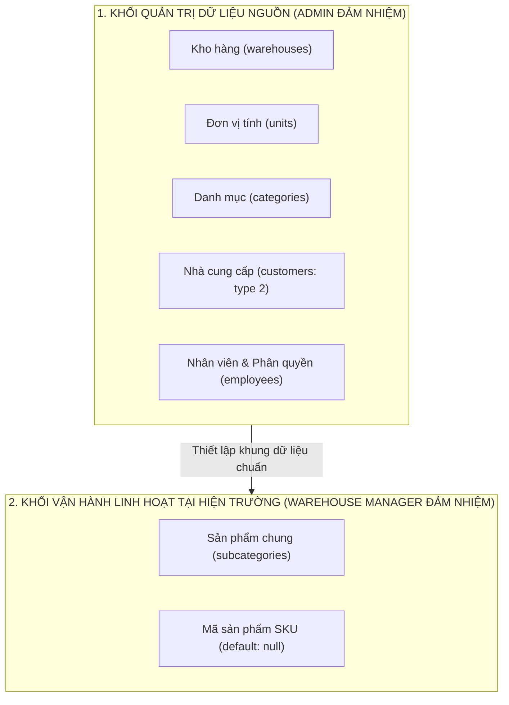

# TỔNG HẬP TƯ DUY: BÓC TÁCH TÁC NHÂN (ACTOR) & THIẾT KẾ DFD LEVEL 0

> **Phạm vi tài liệu:** Đúc kết phương pháp luận, tư duy kiến trúc và bộ luận cứ bảo vệ đồ án cho **Chặng 1 (Module 01 & Module 02 - Hệ thống Quản lý Kho tập trung Công ty ABC)**.
> **Tài liệu đối chiếu:** `md/LessonTwo/bài_tập_api.txt`, `md/LessonTwo/so-do-actor-module-1-2.md`, sơ đồ `drawio/LessonTwo/Actor.drawio`.

---

## 1. Phương pháp luận xác định Tác nhân (Actor) từ đề bài

### 1.1. Bản chất cốt lõi của Tác nhân (Actor)
* **Actor là gì?** Là bất kỳ thực thể nào **nằm ngoài ranh giới hệ thống** (System Boundary), trực tiếp tương tác, gửi dữ liệu yêu cầu (Request) và nhận kết quả phản hồi (Response) từ hệ thống.
* **Actor là Vai trò (Role), không phải con người cụ thể hay chức danh hành chính:** Hệ thống phần mềm chỉ nhận biết token, quyền hạn và hành động tương ứng với vai trò đó.

### 1.2. Kỹ thuật quét đề bài: Tại sao chốt đúng 4 Actor?
Đề bài (`bài_tập_api.txt`) xác định 4 vai trò con người trực tiếp sử dụng API của 2 module nền tảng:
1. **Admin** (Quản trị viên)
2. **Warehouse Manager** (Quản lý kho)
3. **Warehouse Staff** (Nhân viên kho)
4. **Accountant** (Kế toán)

### 1.3. Hai "cái bẫy" nhận diện Actor thường gặp
* **Bẫy 1: Khách hàng và Nhà cung cấp có phải là Actor trong hệ thống này không?**
  * 👉 **KHÔNG.** Trong hệ thống quản lý kho nội bộ B2B/Enterprise này, Khách hàng và Nhà cung cấp không được cấp tài khoản để đăng nhập vào phần mềm. 
  * Thông tin của họ do nhân viên nội bộ nhập liệu và quản lý. Do đó, Khách hàng và Nhà cung cấp chỉ là **Thực thể dữ liệu (Data Entity)** được lưu trong collection `customers`, tuyệt đối không vẽ thành Actor trên DFD Level 0.
* **Bẫy 2: Có Actor Hệ thống ngoài (External System) hay Bộ lập lịch (Scheduler) không?**
  * 👉 **KHÔNG.** Ở phạm vi Module 01 (Xác thực, phân quyền) và Module 02 (Danh mục Master Data), hệ thống chưa tích hợp cổng thanh toán, sàn TMĐT hay đơn vị vận chuyển bên ngoài. Đồng thời, chưa có nghiệp vụ tự động chạy ngầm theo thời gian (cron job) như ở các module xuất/nhập/tồn sau.

---

## 2. Phân tích quyền hạn & Cơ chế phân bổ hành động (18 hành động)

Tổng số 18 hành động trên sơ đồ DFD Level 0 được phân bổ chính xác theo chức năng và quyền hạn:

| STT | Actor | Số hành động | Mã hành động | Căn cứ phân bổ nghiệp vụ |
|:---:|---|:---:|:---:|---|
| 1 | **Admin** | 10 | `[Quản trị - 01..10]` | **Toàn quyền hệ thống:** • Module 01 (4 action): Đăng nhập (`01`), Quản lý tài khoản nhân viên (`02`), Phân quyền vai trò (`03`), Gán nhân viên phụ trách kho (`04`). • Module 02 (6 action): Thiết lập danh mục gốc toàn công ty: Kho hàng (`05`), Danh mục SP (`06`), Đơn vị tính (`07`), Nhà cung cấp (`08`), Khách hàng (`09`), Sản phẩm chung & mã SKU (`10`). |
| 2 | **Warehouse Manager** | 3 | `[Quản lý kho - 01..03]` | **Điều hành chuyên môn kho:** • Đăng nhập & phiên làm việc (`01`). • Quản lý trực tiếp sản phẩm chung (`subcategories`) và mã SKU khi có mặt hàng mới về kho (`02`). • Tra cứu các danh mục Master Data (Kho, Danh mục, ĐVT, NCC) phục vụ giám sát (`03`). |
| 3 | **Warehouse Staff** | 3 | `[Nhân viên kho - 01..03]` | **Thực thi tác nghiệp hiện trường:** • Đăng nhập & phiên làm việc (`01`). • Quét mã vạch / QR hoặc gõ mã SKU để tra cứu thông tin hàng hóa (`02`). • Tra cứu phạm vi kho mà mình được phân công phụ trách (`03`). |
| 4 | **Accountant** | 2 | `[Kế toán - 01..02]` | **Giám sát & Đối soát tài chính:** • Đăng nhập & phiên làm việc (`01`). • Tra cứu danh mục Master Data ở chế độ chỉ đọc (Read-only) để kiểm tra chứng từ, mã thuế, đối soát số liệu (`02`). |

---

## 3. Tư duy Kiến trúc: Ranh giới quyền hạn giữa Admin và Warehouse Manager

> Đây là câu hỏi kinh điển giải quyết mâu thuẫn giữa: **Tính linh hoạt vận hành (Operational Agility)** và **Quản trị dữ liệu & Kiểm soát rủi ro (Data Governance & Fraud Prevention)**.

### 3.1. Tại sao Admin nắm giữ việc tạo Kho, Đơn vị tính, Danh mục và Nhà cung cấp?
1. **Cơ sở kho hàng (`warehouses`):** Mở thêm một kho hàng vật lý gắn liền với chi phí thuê mặt bằng, pháp lý và cấu trúc chi nhánh của doanh nghiệp. Quản lý kho chỉ điều hành trong phạm vi các kho đã có, không thể tự ý tạo kho mới làm sai lệch số liệu tồn kho tập trung.
2. **Đơn vị tính (`units`) & Danh mục (`categories`):** Nếu cho phép nhiều Quản lý kho tự do tạo, dữ liệu sẽ bị "rác" và trùng lặp (ví dụ: kho A tạo *"Cái"*, kho B tạo *"Chiếc"*, kho C tạo *"Hộp 1 chiếc"*). Điều này làm tê liệt khả năng làm báo cáo tồn kho tổng hợp toàn công ty.
3. **Nhà cung cấp (`customers` type = 2) — Nguyên tắc Phân tách trách nhiệm (Separation of Duties - SoD):** 
   * Trong kiểm soát nội bộ, **người giữ kho không được tự tạo đối tác mua hàng**. 
   * Nếu Quản lý kho vừa có quyền tạo Nhà cung cấp, vừa có quyền tạo phiếu nhập kho, họ có thể thông đồng tạo "Nhà cung cấp ma" để đưa hàng giả, hàng trôi nổi vào hệ thống. Nhà cung cấp bắt buộc phải do Admin hoặc Phòng Mua hàng/Kế toán thẩm định tạo trước.

### 3.2. Tại sao Warehouse Manager phải được Toàn quyền (Full CRUD) với Sản phẩm và mã SKU?
* **Đảm bảo tính linh hoạt tối đa (Agility):** Hàng hóa, phụ kiện điện tử mới về kho liên tục. Nếu mỗi lần có linh kiện mới về kho mà Quản lý kho phải làm đơn chờ Admin/IT tạo sản phẩm thì toàn bộ dây chuyền nhập kho và bán hàng sẽ bị đình trệ.
* Do đó, Quản lý kho được trao toàn quyền tạo sản phẩm chung (`subcategories`) và khai báo mã `sku` nội bộ để sẵn sàng lập phiếu nhập kho (`import_form`) và sinh mã QR (`products.ID`) cho từng chiếc hàng hóa thực tế.

---

## 4. Phân biệt nghiệp vụ cốt lõi theo thực tế vận hành Laptop24h: Mã SKU (`subcategories.sku`) và Mã QR / Barcode cá thể (`products.ID`)

Theo tư duy thực tế của Leader tại hệ thống **Laptop24h** (Buổi học số 2), hệ thống **không lưu cột `barcode` tĩnh trên bảng `subcategories`**, mà tách bạch rõ ràng giữa **Mã sản phẩm chung (`sku`)** và **Mã định danh từng cá thể hàng hóa (`products.ID` - Mã QR)**:

| Tiêu chí | Mã sản phẩm chung (`subcategories.sku`) | Mã QR / Barcode cá thể (`products.ID`) |
|---|---|---|
| **Nằm ở bảng nào?** | Collection **`subcategories`** (Bảng sản phẩm chung / mẫu mặt hàng) | Collection **`products`** (Bảng sản phẩm cuối + QR) |
| **Bản chất** | Mã quy ước cho **dòng mặt hàng chung** (VD: dòng *RAM Kingston DDR4 8GB*) | Mã định danh **từng chiếc linh kiện vật lý cụ thể** nằm trên kệ kho (serial / tem QR từng chiếc) |
| **Thời điểm sinh ra** | Khi tạo/cập nhật mặt hàng ở **Module 02** (hoặc để trống `default: null`) | **Tự động sinh ra SAU KHI nhập kho (`import_form`)**: nhập `quantity = 10` chiếc thì sinh 10 bản ghi `products` với 10 mã `ID` khác nhau |
| **Quy tắc giá trị** | Không bắt buộc (`default: null`); nếu nhập thì không trùng | `String, unique, default: Date.now` — Dùng mã của Nhà cung cấp nếu có sẵn trên hàng hóa, hoặc tự động sinh theo `timestamp` (`Date.now`) |
| **Trạng thái đi kèm** | `status: Number` (`1` đang kinh doanh, `0` ngừng kinh doanh) | `status: Boolean` (`default: false` = chưa xuất kho, `true` = đã xuất kho) |
| **Cách dùng thực tế** | Tra cứu dòng sản phẩm chung, chọn mặt hàng khi lập phiếu nhập | Cầm máy quét bắn mã QR/Barcode trên từng chiếc linh kiện để kiểm kho, xuất kho, truy xuất đúng phiếu nhập (`form_import_id`) và bảo hành |

> 💡 **Tại sao thiết kế của Leader ưu việt cho ngành linh kiện / sửa chữa Laptop24h?**
> Hai thanh RAM cùng một mẫu `subcategories` nhưng nhập từ 2 lô/nhà cung cấp khác nhau với giá nhập và hạn bảo hành khác nhau. Nếu dùng chung 1 mã `barcode` cố định ở `subcategories`, khi khách mang 1 thanh RAM đến bảo hành sẽ không biết thanh RAM đó thuộc phiếu nhập nào. Nhờ gắn mã QR (`products.ID`) cho từng cá thể sinh ra từ `import_form`, chỉ cần bắn mã trên tem là truy xuất được ngay phiếu nhập (`form_import_id`), dòng thứ tự (`index`), giá nhập (`price`) và trạng thái xuất kho (`status`)!

---

## 5. Quy tắc thiết kế và vẽ sơ đồ DFD Level 0 (`Actor.drawio`)

1. **Nguyên lý Hộp đen (Black Box):** Toàn bộ hệ thống được gom thành 1 hình chữ nhật / elip trung tâm: `[0] Hệ thống quản lý kho tập trung Công ty ABC`. Không vẽ cấu trúc bên trong (database hay hàm xử lý) lên sơ đồ này.
2. **Quy tắc định danh mã hành động rõ nghĩa:** Toàn bộ hành động chuẩn hóa theo cú pháp `[Tên vai trò - STT]` (ví dụ: `[Quản trị - 01]`, `[Quản lý kho - 02]`, `[Nhân viên kho - 03]`), tuyệt đối không dùng chữ viết tắt mơ hồ (`QT1`, `QLK2`).
3. **Cơ chế Request - Response đối xứng:**
   * Mỗi hành động luôn bao gồm **cặp 2 mũi tên mang cùng mã số**:
     * Mũi tên hướng **vào hệ thống (Input):** Nhãn ghi rõ tên hành động (ví dụ: `[Quản trị - 01] Đăng nhập & Refresh Token`).
     * Mũi tên hướng **ra khỏi hệ thống (Output):** Nhãn ghi kết quả nhận lại (ví dụ: `[Quản trị - 01] Kết quả đăng nhập & Refresh Token`).
   * Giúp người đọc sơ đồ nhận biết tức thì Response nào trả lời cho Request nào.

---

## 6. Bộ câu hỏi vấn đáp trọng tâm (Q&A) khi nộp bài

### Câu 1: Tại sao không gộp Warehouse Manager và Warehouse Staff thành 1 Actor là "Nhân viên kho"?
> **Đáp án:** Vì ranh giới trách nhiệm hoàn toàn khác nhau. `Warehouse Manager` là cấp quản trị kho, có quyền tạo sửa mặt hàng (`subcategories`), định giá và thiết lập mã SKU. Trong khi đó, `Warehouse Staff` là nhân viên tác nghiệp thuần túy, chỉ được cấp quyền tra cứu/quét mã và chỉ được thao tác trong phạm vi các kho mà Admin đã gán (`warehouse_ids`), không được phép sửa đổi thông tin danh mục.

### Câu 2: Khách hàng và Nhà cung cấp lưu chung một bảng `customers` có hợp lý không?
> **Đáp án:** Rất hợp lý và bám sát chuẩn thiết kế của Leader. Cả Khách hàng, Khách thợ và Nhà cung cấp đều có chung các thuộc tính pháp nhân (Tên, SĐT, Địa chỉ, Mã số thuế, Email). Việc dùng chung bảng và phân biệt bằng cột `type` (`1`: Khách hàng, `2`: Nhà cung cấp, `3`: Khách thợ) giúp tối ưu hóa cấu trúc cơ sở dữ liệu và tái sử dụng toàn bộ logic quản lý đối tác công nợ ở các module chứng từ sau này.

### Câu 3: DFD Level 0 khác gì với Sơ đồ phân rã chức năng (FDD)?
> **Đáp án:**
> * **DFD Level 0** nhìn hệ thống **từ ngoài vào**: Trả lời câu hỏi *"Ai (Who) tương tác và trao đổi luồng dữ liệu gì với hệ thống?"*. Hành động được phân nhóm theo Actor.
> * **FDD** mở hộp đen hệ thống, nhìn **từ trong ra**: Trả lời câu hỏi *"Hệ thống gồm những khối chức năng nào (What)?"*. Các chức năng được gom nhóm theo Miền nghiệp vụ / Đối tượng dữ liệu theo nguyên tắc MECE (không trùng lặp, không bỏ sót), bỏ qua yếu tố ai là người bấm nút.
