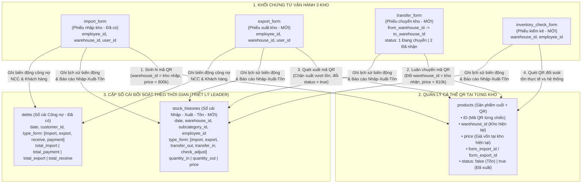
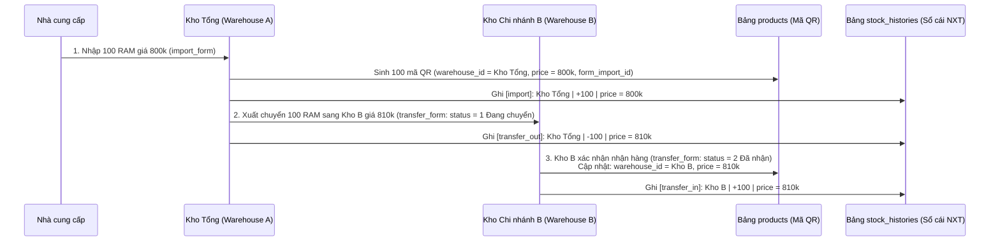

# TƯ DUY NÂNG CẤP DATABASE: GIẢI QUYẾT BÀI TOÁN QUẢN LÝ 3 KHO TẬP TRUNG & CHÊNH LỆCH GIÁ LUÂN CHUYỂN

> **Phạm vi tài liệu:** Phân tích khoảng trống giữa sơ đồ Nhập kho ban đầu (Buổi học số 2) với bài toán thực tế quản lý 3 kho hàng của Công ty ABC (`md/LessonTwo/bài_tập_api.txt`), đồng thời đề xuất phương án nâng cấp Database tuân thủ 100% triết lý thiết kế hệ thống Laptop24h của Leader.
> **Tài liệu liên quan:** `md/LessonTwo/thiet-ke-database-bai-tap-2.md`, `md/LessonTwo/tu-duy-phan-tich-va-xay-dung-database.md`, `drawio/LessonTwo/Database.drawio`.

---

## 1. Đặt vấn đề: Tại sao thiết kế chỉ có Nghiệp vụ Nhập kho (`import_form`) là chưa đủ?

### 1.1. 6 Nỗi đau (Pain Points) cốt lõi trong đề bài Công ty ABC
Công ty ABC có **3 kho hàng tại các địa điểm khác nhau** (bao gồm Kho Tổng và các Kho Chi nhánh). Việc quản lý bằng Excel dẫn đến 6 vấn đề:
1. Không kiểm soát được **số lượng hàng tồn thực tế** tại từng kho.
2. Không biết **nhân viên nào** thực hiện nhập hoặc xuất hàng.
3. Dễ xảy ra tình trạng **xuất hàng vượt quá số lượng tồn kho** (xuất âm kho).
4. Khó theo dõi **lịch sử biến động hàng hóa** (một sản phẩm đã đi qua những kho nào, qua tay ai).
5. Không kiểm soát được **hàng hóa đang vận chuyển giữa các kho** (*In-Transit*).
6. Khó tổng hợp **báo cáo Nhập - Xuất - Tồn theo thời gian** (ทั้ง về số lượng lẫn giá trị tiền).

### 1.2. Bài toán thực tế về Giá luân chuyển giữa Kho Tổng $\leftrightarrow$ Kho Chi nhánh
Trong vận hành thực tế của chuỗi cửa hàng / kho (như Laptop24h):
* Hàng hóa nhập từ Nhà cung cấp thường về **Kho Tổng** trước, sau đó **xuất điều chuyển về các Kho Chi nhánh**; hoặc ngược lại, **luân chuyển từ Chi nhánh về Kho Tổng**.
* **Giá nhập và giá xuất của cùng 1 sản phẩm thay đổi theo thời gian và theo từng chặng:**
  * *Ví dụ:* Kho Tổng nhập 100 thanh RAM từ Nhà cung cấp với giá **`800.000đ`/thanh**.
  * Khi Kho Tổng xuất điều chuyển sang **Kho B**, giá xuất nội bộ là **`810.000đ`/thanh** (cộng chi phí vận chuyển / quản lý kho tổng). Lúc này, giá vốn đầu vào của Kho B phải là **`810.000đ`** chứ không phải `800.000đ`.
  * Nếu một thời gian sau Kho B chuyển ngược về Kho Tổng hoặc xuất bán lẻ cho khách với giá **`950.000đ`**, hệ thống phải lưu vết được đúng mức giá tại từng thời điểm mà **không làm mất giá nhập gốc `800.000đ` ban đầu**.

---

## 2. Phân tích Khoảng trống (Gap Analysis) của Thiết kế hiện tại

Trong Buổi học số 2, do dừng sớm để xử lý phần thuế nên sơ đồ của Leader mới dừng ở luồng **Nhập kho (`import_form`) $\rightarrow$ Sinh mã QR (`products`) $\rightarrow$ Công nợ (`debts`)**. Nếu giữ nguyên thiết kế đó sẽ thiếu 5 mảnh ghép:

| # | Vấn đề thực tế | Điểm khuyết trong DB hiện tại | Hướng nâng cấp theo đúng chuẩn Leader |
|---|---|---|---|
| **1** | Quản lý tồn tại **3 kho khác nhau** | Bảng `products (mã QR)` mới có `form_import_id` và `status: false/true`, **chưa có trường `warehouse_id` hiện tại** để biết chiếc hàng đang nằm ở kho nào sau khi luân chuyển. | Bổ sung `warehouse_id` (kho hiện tại) và `form_export_id` (phiếu xuất) vào bảng `products`. |
| **2** | Контроl **Xuất hàng** & **Chống xuất vượt tồn** | Chưa có bảng Phiếu xuất kho. | Bổ sung bảng **`export_form` (Phiếu xuất kho)** có cấu trúc đối xứng 100% với `import_form`. Khi xuất bắt buộc kiểm tra `products.warehouse_id` và `products.status == false`. |
| **3** | Kiểm soát **hàng đang vận chuyển giữa các kho** & **Chênh lệch giá `800k -> 810k`** | Chưa có bảng Chuyển kho và cơ chế lưu giá điều chuyển nội bộ. | Bổ sung bảng **`transfer_form` (Phiếu chuyển kho)** tái sử dụng cấu trúc `detail_product` (có `price = 810k`, `total_amount`) và trạng thái `status = 1` (*Đang vận chuyển*), `status = 2` (*Đã nhận*). |
| **4** | Đối soát **số lượng tồn thực tế** khi kiểm kê | Chưa có bảng Kiểm kê kho. | Bổ sung bảng **`inventory_check_form` (Phiếu kiểm kê kho)** đối soát số lượng quét QR thực tế với tồn hệ thống tại từng kho. |
| **5** | Truy vết **lịch sử biến động** & **Báo cáo Nhập - Xuất - Tồn theo thời gian** | Đếm trên `products` chỉ biết tồn **tại thời điểm hiện tại**, không thể tính tồn đầu kỳ / cuối kỳ của tháng trước. | Áp dụng **đúng tư duy bảng Sổ cái `debts` của Leader** sang cho Hàng hóa: tạo bảng **`stock_histories` (Sổ cái Nhập - Xuất - Tồn)** lưu mọi biến động kèm `quantity_in`, `quantity_out` và `price`. |

---

## 3. Kiến trúc Luồng Dữ liệu & Cơ chế Giá sau nâng cấp

### 3.1. Sơ đồ tổng thể Luồng Chứng từ $\rightarrow$ Cá thể QR $\rightarrow$ Cặp Sổ cái Đối soát

---

### 3.2. Giải quyết bài toán Chênh lệch giá `800k -> 810k` khi luân chuyển giữa các kho

Cơ chế 3 lớp này đảm bảo **không mất dữ liệu gốc** và **hạch toán chính xác tại mọi thời điểm**:
1. **Lớp 1 — Giữ nguyên giá nhập gốc `800k` từ Nhà cung cấp:**
   * Mỗi cá thể trong `products` luôn giữ khóa ngoại `form_import_id` và `index` trỏ về dòng sản phẩm trong `import_form` gốc. Bất kỳ lúc nào cần tra cứu *"Thanh RAM mã QR này lúc đầu mua của Nhà cung cấp nào, giá gốc bao nhiêu?"*, hệ thống đều lấy được chính xác `800k` từ `import_form`.
2. **Lớp 2 — Ghi nhận giá điều chuyển `810k` trên `transfer_form` và cập nhật giá vốn tại kho đích:**
   * Mảng `product` trong `transfer_form` tái sử dụng cấu trúc `detail_product` của Leader (có trường `price = 810k`, `quantity = 100`, `vat`, `ck`, `discount` và mảng `product_ids` chứa danh sách mã QR được chuyển).
   * Khi Kho B xác nhận đã nhận hàng (`transfer_form.status = 2`), các bản ghi `products` tương ứng được cập nhật `warehouse_id = Kho B` và `price = 810k` (giá vốn hiện tại ở Kho B).
3. **Lớp 3 — Lưu vết toàn bộ lịch sử giá và số lượng theo thời gian trong `stock_histories`:**

| Thời điểm (`date`) | Kho (`warehouse_id`) | Loại giao dịch (`type_form`) | Nhập (`quantity_in`) | Xuất (`quantity_out`) | Đơn giá (`price`) | Ý nghĩa nghiệp vụ |
|---|---|---|:---:|:---:|---|---|
| `01/11/2026` | Kho Tổng | `import` | `100` | `0` | **`800.000`** | Kho Tổng nhập từ NCC giá 800k |
| `05/11/2026` | Kho Tổng | `transfer_out` | `0` | `100` | **`810.000`** | Kho Tổng xuất điều chuyển sang Kho B giá 810k |
| `06/11/2026` | Kho B | `transfer_in` | `100` | `0` | **`810.000`** | Kho B nhận hàng từ Kho Tổng với giá vốn 810k |
| `10/11/2026` | Kho B | `export` | `0` | `10` | **`950.000`** | Kho B xuất bán cho khách giá 950k (Lãi tại Kho B = $950k - 810k$) |

---

## 4. Đặc tả chi tiết các Collection Nâng cấp & Bổ sung mới (Chuẩn 4 cột của Leader)

### 4.1. Bảng `products (sản phẩm cuối + QR)` — Bản nâng cấp đa kho
> Kế thừa nguyên vẹn 7 trường gốc của Leader trong `bảng 2.json` và bổ sung 2 trường (`warehouse_id`, `form_export_id`) để kiểm soát vị trí hiện tại của từng mã QR trong 3 kho.

| field | type | required | des |
|---|---|---|---|
| _id | ObjectId | true | _id hệ thống tự sinh |
| ID | String, unique | default: Date.now | mã QR định danh từng chiếc (theo mã NCC hoặc sinh theo timestamp) |
| subcategory_id | ObjectId, Index | true | sản phẩm chung (ref `subcategories`) |
| warehouse_id | ObjectId, Index | true | kho hiện tại đang lưu giữ sản phẩm (ref `warehouses` — cập nhật khi chuyển kho) |
| form_import_id | ObjectId | true | phiếu nhập sinh ra sản phẩm (ref `import_form`) |
| form_export_id | ObjectId | default: null | phiếu xuất đã xuất sản phẩm này (ref `export_form`, `null` = chưa xuất) |
| index | Number | | thứ tự dòng trong chi tiết phiếu nhập |
| price | Number | default = 0 | giá vốn hiện tại của sản phẩm tại kho đang lưu giữ |
| status | Boolean, Index | default: false | mặc định `false` = đang tồn kho (chưa xuất), `true` = đã xuất kho |

---

### 4.2. Bảng `export_form` — Phiếu xuất kho (Bổ sung mới)
> Thiết kế đối xứng 100% với bảng `import_form` của Leader. Khi hoàn tất phiếu xuất sẽ đổi `products.status = true`, ghi vào `stock_histories` (`type_form = 'export'`) và ghi vào `debts` (`type_form = 'export'`, `total_export`).

| field | type | required | des |
|---|---|---|---|
| _id | ObjectId | true | _id hệ thống tự sinh |
| ID | String, unique | true | mã phiếu xuất (VD: `PX001`) |
| employee_id | ObjectId, Index | true | nhân viên lập phiếu xuất (ref `employees`) |
| user_id | ObjectId, Index | true | khách hàng / khách thợ mua hàng (ref `customers`) |
| warehouse_id | ObjectId, Index | true | kho xuất hàng (ref `warehouses`) |
| branch_id | ObjectId | default: null | chi nhánh (ref `branches`) |
| date | Date, Index | true, default: Date.now | ngày tạo phiếu xuất |
| total_amount | Number | default = 0 | tổng tiền phiếu xuất |
| product | Array (`detail_product`) | default : [ ] | chi tiết sản phẩm linh kiện xuất kho |
| service | Array (`detail_product`) | default : [ ] | chi tiết sản phẩm dịch vụ |

---

### 4.3. Bảng `transfer_form` — Phiếu chuyển kho giữa các kho (Bổ sung mới)
> Quản lý luồng điều chuyển hàng hóa hai chiều (Kho Tổng $\rightarrow$ Kho Chi nhánh và Chi nhánh $\rightarrow$ Kho Tổng), kiểm soát hàng đang đi trên đường (`status = 1`) và lưu đơn giá điều chuyển tại thời điểm xuất (`price` trong `detail_product`).

| field | type | required | des |
|---|---|---|---|
| _id | ObjectId | true | _id hệ thống tự sinh |
| ID | String, unique | true | mã phiếu chuyển kho (VD: `CK001`) |
| from_warehouse_id | ObjectId, Index | true | kho xuất chuyển đi (ref `warehouses` — VD: Kho Tổng) |
| to_warehouse_id | ObjectId, Index | true | kho nhận chuyển đến (ref `warehouses` — VD: Kho B) |
| export_employee_id | ObjectId, Index | true | nhân viên kho xuất bàn giao hàng (ref `employees`) |
| receive_employee_id | ObjectId | default: null | nhân viên kho đích xác nhận nhận hàng (ref `employees`) |
| date | Date, Index | true, default: Date.now | ngày tạo phiếu chuyển kho |
| received_date | Date | default: null | ngày kho đích xác nhận đã nhận hàng |
| total_amount | Number | default = 0 | tổng giá trị tiền hàng điều chuyển |
| product | Array (`detail_product`) | default : [ ] | chi tiết hàng chuyển (gồm `subcategory_id`, `price`, `quantity`, `vat`, `ck`, `warranty`, `discount`, kèm `product_ids` [mảng mã QR]) |
| note | String | default: null | ghi chú điều chuyển |
| status | Number, Index | true, default = 1 | `1` đang vận chuyển giữa các kho, `2` kho đích đã nhận, `0` đã hủy |

---

### 4.4. Bảng `inventory_check_form` — Phiếu kiểm kê kho (Bổ sung mới)
> Phục vụ kiểm kê định kỳ hoặc đột xuất tại từng kho bằng máy quét QR, phát hiện chênh lệch thừa/thiếu giữa thực tế và sổ sách.

| field | type | required | des |
|---|---|---|---|
| _id | ObjectId | true | _id hệ thống tự sinh |
| ID | String, unique | true | mã phiếu kiểm kê (VD: `KK001`) |
| warehouse_id | ObjectId, Index | true | kho thực hiện kiểm kê (ref `warehouses`) |
| employee_id | ObjectId, Index | true | nhân viên thực hiện kiểm kê (ref `employees`) |
| date | Date, Index | true, default: Date.now | ngày tạo phiếu kiểm kê |
| details | Array | default : [ ] | chi tiết kiểm kê (`subcategory_id`, `system_quantity`, `actual_quantity`, `diff_quantity`, `note`) |
| note | String | default: null | ghi chú kiểm kê |
| status | Number, Index | true, default = 1 | `1` đang kiểm kê, `2` đã chốt cân bằng kho, `0` đã hủy |

---

### 4.5. Bảng `stock_histories` — Sổ cái Lịch sử biến động & Báo cáo Nhập - Xuất - Tồn (Bổ sung mới)
> Thiết kế song hành với bảng `debts` của Leader: `debts` là Sổ cái cho **Tiền & Công nợ**, còn `stock_histories` là Sổ cái cho **Hàng hóa & Giá trị Nhập - Xuất - Tồn**.

| field | type | required | des |
|---|---|---|---|
| _id | ObjectId | true | _id hệ thống tự sinh |
| date | Date, Index | true, default: Date.now | ngày phát sinh biến động hàng hóa |
| warehouse_id | ObjectId, Index | true | kho phát sinh biến động (ref `warehouses`) |
| subcategory_id | ObjectId, Index | true | sản phẩm biến động (ref `subcategories`) |
| employee_id | ObjectId, Index | true | nhân viên thực hiện nhập / xuất / chuyển / kiểm kê (ref `employees`) |
| form_id | ObjectId | true | id chứng từ gốc (`import_form`, `export_form`, `transfer_form`, `inventory_check_form`) |
| type_form | String, Index | [import, export, transfer_out, transfer_in, check_adjust] | loại giao dịch làm biến động tồn kho |
| quantity_in | Number | default = 0 | số lượng nhập vào kho (làm tăng tồn kho) |
| quantity_out | Number | default = 0 | số lượng xuất ra khỏi kho (làm giảm tồn kho) |
| price | Number | default = 0 | đơn giá tại thời điểm giao dịch (phục vụ tính giá trị Nhập - Xuất - Tồn) |

---

## 5. Tổng kết: Giá trị mang lại của Phương án Nâng cấp

1. **Giải quyết 100% 6 bài toán của Ban lãnh đạo Công ty ABC:**
   * Kiểm soát chính xác tồn thực tế từng kho đến từng mã QR (`products.warehouse_id` + `inventory_check_form`).
   * Truy vết rõ nhân viên nào nhập, ai xuất, ai giao, ai nhận (`employee_id` trên mọi chứng từ và trên `stock_histories`).
   * Chặn tuyệt đối xuất âm kho hoặc bán nhầm hàng đang vận chuyển.
   * Theo dõi hàng đang vận chuyển giữa 3 kho qua `transfer_form.status = 1`.
   * Tổng hợp báo cáo Nhập - Xuất - Tồn theo kỳ cực nhanh bằng 1 pipeline `$group` trên `stock_histories`.
2. **Xử lý trọn vẹn bài toán chênh lệch giá `800k -> 810k`:**
   * Lưu giữ đầy đủ cả **giá nhập gốc từ NCC (`800k`)**, **giá điều chuyển nội bộ sang chi nhánh (`810k`)**, và **giá xuất bán lẻ (`950k`)** theo dòng thời gian.
3. **Đồng nhất 100% với phong cách thiết kế của Leader:**
   * Không phá vỡ bất kỳ bảng nào Leader đã chốt trong Buổi học số 2 (`import_form`, `detail_product`, `products`, `payment_form`, `debts`), mà mở rộng tự nhiên theo đúng quy ước `snake_case`, nhúng mảng `detail_product` và mô hình Sổ cái (Ledger).

