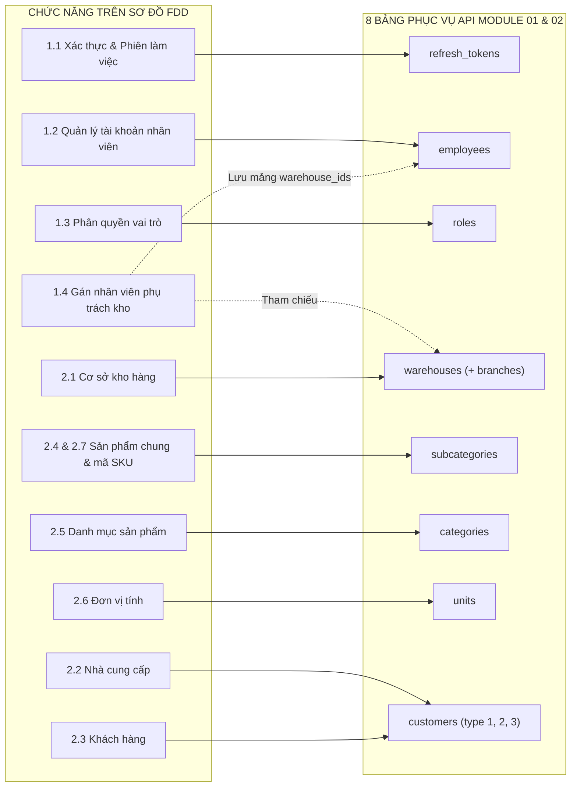
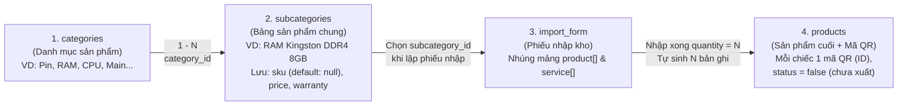
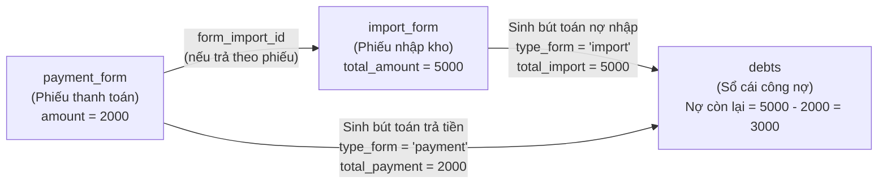

# TỔNG HỢP TƯ DUY: PHÂN TÍCH & XÂY DỰNG CƠ SỞ DỮ LIỆU (DATABASE DESIGN)

> **Phạm vi tài liệu:** Đúc kết phương pháp luận chuyển đổi từ Sơ đồ phân rã chức năng (FDD) và nghiệp vụ thực tế của **Laptop24h (Buổi học số 2 - 31/10/2026)** sang thiết kế Database MongoDB hoàn chỉnh.
> **Tài liệu đối chiếu:** `drawio/LessonTwo/Database.drawio`, `md/LessonTwo/thiet-ke-database-bai-tap-2.md`, `.agents/rules/database_design.md`.

---

## 1. Nguyên tắc cốt lõi khi thiết kế Database từ FDD

Database không bao giờ được vẽ một cách cảm tính mà là **bản dịch trực tiếp từ Sơ đồ phân rã chức năng (FDD)** và **Quy tắc nghiệp vụ** theo 4 bước chuẩn:
1. **Tìm danh từ cốt lõi (Core Entities) trên FDD:** Mỗi nhóm chức năng quản lý một đối tượng dữ liệu trên FDD sẽ tương ứng với một bảng (Collection).
2. **Xác định thuộc tính (Fields & Types):** Nhìn vào dữ liệu Input/Output của từng chức năng để xác định các cột cần lưu, kiểu dữ liệu, giá trị mặc định (`default`) và đánh chỉ mục (`unique`, `Index`).
3. **Thiết lập mối quan hệ (Relationships / Foreign Keys):** Xác định quan hệ $1 - N$, $N - N$ hoặc tự tham chiếu (cây cha - con) giữa các bảng.
4. **Đối chiếu quy tắc nghiệp vụ của Leader:** Đảm bảo 100% tên bảng, tên trường và luồng sinh dữ liệu khớp với thực tế vận hành của hệ thống nhà mình (Laptop24h).

---

## 2. Sơ đồ ánh xạ từ FDD sang các Bảng Database

---

## 3. Logic nghiệp vụ đặc thù của Laptop24h (Chốt tại Buổi học số 2 - 31/10/2026)

Đây là phần **quan trọng nhất** thể hiện bạn nắm vững hệ thống thực tế của công ty và không dùng nhầm tư duy sơ đồ cũ:

### 3.1. Phân tầng 3 bảng Hàng hóa: `categories` $\rightarrow$ `subcategories` $\rightarrow$ `products`

1. **Bảng `categories` (Danh mục sản phẩm):**
   * Lưu các nhóm danh mục loại hàng hóa như: *Pin, RAM, CPU, Main, Màn hình, Ổ cứng...*
   * Sử dụng trường `parent_id` (`default: null`) để hỗ trợ phân cấp danh mục cha - con.
   * Nối xuống bảng sản phẩm `subcategories` qua khóa ngoại `category_id`.

2. **Bảng `subcategories` (Bảng sản phẩm / Sản phẩm chung):**
   * **Lưu ý thuật ngữ:** Dù tên bảng tiếng Anh trong DB đặt là `subcategories` (nếu dịch nghĩa đen dễ nhầm là "danh mục con"), nhưng **thực chất trong hệ thống Laptop24h đây chính là BẢNG SẢN PHẨM (mẫu sản phẩm / mặt hàng chung)**.
   * Lưu thông tin định danh mặt hàng chung: `name` (tên sản phẩm), `category_id` (danh mục), `unit_id` (đơn vị tính), `sku` (mã sản phẩm, `default: null`), `price` (giá bán), `warranty` (thời hạn bảo hành). Không lưu `barcode` cố định ở đây vì mã quét định danh từng chiếc sản phẩm nằm ở `products.ID` (mã QR).
   * Đóng vai trò là dữ liệu nguồn (Master Data) để thực hiện `CRUD sản phẩm` ở Module 02 và để nhân viên kho chọn (`subcategory_id`) khi lập phiếu nhập kho.

3. **Bảng `products` (Sản phẩm cuối + Mã QR):**
   * **Không phải** bảng khai báo thông tin mặt hàng ban đầu.
   * Đây là bảng lưu **từng cá thể hàng hóa vật lý thực tế (từng thanh RAM, từng viên Pin cụ thể)** nằm trong kho.
   * **Cách sinh dữ liệu:** Chỉ được sinh ra tự động **SAU KHI hoàn tất phiếu nhập kho (`import_form`)**. Ví dụ: nhập 10 thanh *RAM Kingston 8GB* (`subcategory_id`) thì hệ thống tự đẻ ra 10 dòng trong bảng `products`.
   * **Cấu trúc định danh QR:**
     * `ID` (`String, unique`): Chính là **Mã QR** dán lên từng sản phẩm. Nếu nhà cung cấp có sẵn mã thì dùng mã của nhà cung cấp; nếu không có thì hệ thống tự sinh theo `timestamp` (`default: Date.now`).
     * `subcategory_id`: Trỏ về bảng sản phẩm `subcategories`.
     * `form_import_id` & `index`: Trỏ về phiếu nhập kho và số thứ tự dòng trong phiếu nhập đã sinh ra chiếc sản phẩm đó (giúp truy xuất nguồn gốc lô hàng, nhà cung cấp, giá nhập).
     * `status` (`Boolean, default: false`): Mặc định khi mới nhập vào kho là **`false` (chưa xuất kho)**. Khi chiếc sản phẩm đó được bán/xuất kho thì chuyển sang `true`.

---

### 3.2. Cấu trúc Phiếu nhập kho (`import_form`), Phiếu thanh toán (`payment_form`) & Sổ cái Công nợ (`debts`)

1. **Bảng `import_form` (Phiếu nhập kho):**
   * **Không tách bảng chi tiết rời như sơ đồ cũ**, mà nhúng trực tiếp vào `import_form` thành **2 mảng riêng biệt**:
     * `product` (`Array`): Mảng chi tiết **sản phẩm linh kiện** (hàng vật lý — sau khi nhập sẽ sinh ra mã QR trong bảng `products`).
     * `service` (`Array`): Mảng chi tiết **sản phẩm dịch vụ** (không sinh mã QR vật lý).
   * Mỗi phần tử trong mảng chi tiết (`detail_product`) gồm 8 trường riêng biệt:
     * `index` (`Number`, `true`): Số thứ tự dòng trong phiếu nhập.
     * `subcategory_id` (`ObjectId`, `true`): Sản phẩm nhập (tham chiếu `subcategories`).
     * `price` (`Number`, `default = 0`): Giá nhập.
     * `quantity` (`Number`, `default = 0`): Số lượng nhập.
     * `vat` (`Number`, `default = 0`): Thuế VAT.
     * `ck` (`Number`, `default = 0, max = 100`): Chiết khấu (%).
     * `warranty` (`Number`, `default = 0`): Bảo hành (tháng).
     * `discount` (`Number`, `default = 0`): Giảm giá.
   * Trên phiếu nhập `import_form` có đủ: `ID`, `date` (ngày tạo phiếu riêng), `employee_id` (nhân viên lập), `user_id` (nhà cung cấp), `warehouse_id` (kho nhận), `branch_id` (chi nhánh) và `total_amount` (tổng tiền tính từ chi tiết).

2. **Tách bạch `payment_form` (Chứng từ thanh toán) và `debts` (Sổ cái công nợ):**

   * **Bảng `payment_form` (Chứng từ Phiếu Thanh Toán — Phiếu Chi / Thu) & 2 bảng cấu hình động (`type_payments`, `content_payments`):**
     * Lưu sự kiện tiền đi ra / đi vào quỹ: `_id`, `ID` (mã phiếu), `amount` (số tiền thanh toán, `default = 0`), `customer_id` (đối tác nhận/nộp tiền), `form_import_id` (`null` nếu trả gộp công nợ, hoặc trỏ vào `import_form._id` nếu trả đích danh cho 1 phiếu nhập), `note` (`default null`), `type_payment_id` (ref `type_payments`), `content_payment` (ref `content_payments`).
     * **Tại sao `type_payment_id` và `content_payment` có kiểu `ObjectId` và tách thành 2 bảng riêng?** Vì trong vận hành thực tế, Hình thức thanh toán (*tiền mặt, chuyển khoản, ví điện tử...*) và Nội dung thanh toán (*thanh toán cho nhà cung cấp, thanh toán phòng ban nội bộ, chi phí vận hành...*) là **dữ liệu động** do người dùng tự cấu hình thêm/sửa/ẩn (`status`), không thể hardcode enum cố định trong code.
   * **Bảng `debts` (Sổ cái theo dõi biến động Công nợ — Debt Ledger):**
     * Không lưu thông tin quỹ hay hình thức chuyển khoản, mà chuyên làm **Sổ cái hạch toán tăng/giảm công nợ** theo từng chứng từ gốc (`type_form` thuộc `[import, export, receive, payment]`).
     * Gồm 9 trường riêng biệt: `_id`, `date` (`default: Date.now`), `customer_id`, `(id chứng từ)` (`ObjectId`), `type_form`, `total_import`, `total_payment`, `total_export`, `total_receive`.
     * **Công thức đối ứng 2 chiều của Leader:**
       * Với Nhà cung cấp: $\text{Nợ phải trả} = \sum \text{total\_import} \text{ (VD: 5000)} - \sum \text{total\_payment} \text{ (VD: 2000)} = 3000$.
       * Với Khách hàng / Khách thợ: $\text{Nợ phải thu} = \sum \text{total\_export} - \sum \text{total\_receive}$.

---

## 4. Giải phẫu chi tiết 8 Bảng thuộc phạm vi API Module 01 & Module 02

### 4.1. Khối Module 01: Người dùng & Phân quyền (Màu tím trên `Database.drawio`)

| Bảng | Các trường cốt lõi | Giải thích lý do thiết kế (Why?) |
|---|---|---|
| **`roles`** | `_id`, `ID` (`unique`), `name`, `permissions` (`Array`), `status` | • Tách bảng `roles` riêng để quản lý 4 vai trò (`ADMIN`, `WAREHOUSE_MANAGER`, `WAREHOUSE_STAFF`, `ACCOUNTANT`) và mảng quyền `permissions`, giúp mở rộng quyền động mà không cần sửa code. |
| **`employees`** | `_id`, `ID` (`unique`), `name`, `phone` (`unique`), `password` (`sha512`), `role_id`, `warehouse_ids` (`Array`), `status`, `unsign_search` | • Dùng `phone` làm tài khoản đăng nhập duy nhất. • `role_id` tham chiếu sang `roles` (mỗi nhân viên có 1 vai trò chính). • Nhúng mảng `warehouse_ids: [ObjectId]` trực tiếp trong `employees` để khi xác thực JWT biết ngay nhân viên được phép truy cập những kho nào mà không cần `$lookup` bảng trung gian. |
| **`refresh_tokens`** | `_id`, `employee_id`, `token` (`sha512, unique`), `expired_at`, `status` | • Lưu phiên đăng nhập dài hạn (7 ngày). • Khi nhân viên nhấn Đăng xuất (`logout`) hoặc khi Admin khóa tài khoản nhân viên (`employees.status = 0`), hệ thống chuyển `refresh_tokens.status = 0` để chặn cấp lại Access Token ngay lập tức. |

### 4.2. Khối Module 02: Quản lý Danh mục - Master Data (Màu xanh & cam trên `Database.drawio`)

| Bảng | Các trường cốt lõi | Giải thích lý do thiết kế (Why?) |
|---|---|---|
| **`warehouses`** | `_id`, `ID` (`unique`), `name`, `phone`, `address`, `branch_id`, `status`, `unsign_search` | • Quản lý 3 kho hàng vật lý. • Có `branch_id` liên kết với bảng `branches` (chi nhánh) theo đúng mô hình đa chi nhánh - đa kho của công ty. |
| **`customers`** | `_id`, `ID` (`unique`), `type` (`1` KH, `2` NCC, `3` Khách thợ), `name`, `phone`, `gender`, `birthday`, `address` (`Array`), `email`, `tax`, `status`, `unsign_search` | • **Gộp chung Khách hàng, Nhà cung cấp và Khách thợ vào 1 bảng duy nhất**, phân biệt bằng trường `type` (`1`: Khách hàng, `2`: Nhà cung cấp, `3`: Khách thợ). • Kế thừa chuẩn của Leader: giúp bảng phiếu nhập, phiếu thu/chi và công nợ (`debts`) chỉ cần trỏ về 1 khóa ngoại đối tác duy nhất (`customer_id` / `user_id`). • Trường `address` để kiểu `Array` vì một khách hàng/nhà cung cấp có thể có nhiều địa chỉ giao nhận. |
| **`categories`** | `_id`, `parent_id` (`default: null`), `name`, `status`, `unsign_search` | • Lưu danh mục sản phẩm (*Pin, RAM, CPU, Main...*). • Dùng `parent_id` tự tham chiếu chính bảng `categories` để hỗ trợ cây danh mục đa cấp. |
| **`units`** | `_id`, `name` (`unique`), `status` | • Chuẩn hóa danh mục Đơn vị tính (*Cái, Chiếc, Hộp, Bộ...*), đánh `unique` trên `name` để chống tạo trùng. |
| **`subcategories`** | `_id`, `category_id`, `unit_id`, `name`, `sku` (`default: null`), `price`, `warranty`, `status`, `unsign_search` | • Bảng sản phẩm chung: liên kết tới `categories` (`category_id`) và `units` (`unit_id`). • Trường `sku` để `default: null` (không bắt buộc nhập ngay lúc tạo); còn mã quét định danh từng chiếc hàng hóa thực tế nằm ở bảng `products` (`ID` / mã QR sinh ra khi nhập kho). |

---

## 5. Bảng kiểm tra tuân thủ Quy chuẩn Leader (`.agents/rules/database_design.md`)

Toàn bộ các bảng trong thiết kế đều tuân thủ 100% 7 quy ước bắt buộc của Leader:

1. **Định danh kép (`_id` và `ID`):**
   * `_id: ObjectId`: Khóa chính hệ thống tự sinh, dùng để liên kết khóa ngoại (ref).
   * `ID: String, unique`: Mã định danh nghiệp vụ tường minh (`NV001`, `KHO01`, `KH001`, `NCC001`, hoặc mã QR trên bảng `products`).
2. **Quy ước `snake_case`:** Toàn bộ tên bảng và tên trường đều viết thường phân cách bằng dấu gạch dưới (`role_id`, `warehouse_ids`, `parent_id`, `category_id`, `unit_id`, `unsign_search`).
3. **Quy ước trạng thái (`status`):**
   * Toàn bộ các bảng danh mục và tài khoản dùng `status: Number, Index, true, default = 1` (`1`: đang hoạt động, `0`: dừng hoạt động / khóa).
   * Riêng bảng **`products (sản phẩm cuối + QR)`** dùng `status: Boolean, default: false` (`false`: chưa xuất kho, `true`: đã xuất kho).
4. **Tìm kiếm tiếng Việt (`unsign_search`):** Do đặc thù tiếng Việt, mọi bảng có nhu cầu tìm kiếm theo từ khóa (`employees`, `warehouses`, `customers`, `categories`, `subcategories`) đều có trường `unsign_search: String, Index` lưu đồng thời **cả nội dung có dấu và không dấu** (chữ thường), giúp tìm kiếm chính xác cả khi người dùng gõ có dấu lẫn không dấu.
5. **Mã hóa mật khẩu:** Trường `password` trong `employees` (và `token` trong `refresh_tokens`) lưu dạng mã hóa **`sha512`**.
6. **Giá trị mặc định (`default`):**
   * Các trường số tiền, giá, số lượng, thuế, bảo hành: `Number, default = 0`.
   * Các trường mảng (`permissions`, `warehouse_ids`, `address`, `product`, `service`): `Array, default : [ ]`.
   * Tham chiếu không bắt buộc (`parent_id`, `branch_id`, `birthday`, `form_import_id`): `default: null`.
7. **Thời gian tự động (`timestamps: true`):** Mọi schema khi đưa vào Mongoose đều bật `timestamps: true` để tự động quản lý `createdAt` và `updatedAt`.

---

## 6. Bộ câu hỏi phản biện Database thường gặp & Cách trả lời mẫu

### Câu 1: Tại sao không lưu cột `quantity` (số lượng tồn kho) trực tiếp trong bảng `subcategories`?
> **Trả lời:**
> Trong hệ thống kho của Laptop24h, mỗi chiếc linh kiện/máy tính nhập về đều phải quản lý theo từng cá thể gắn **mã QR riêng** (trong bảng `products`) để theo dõi chính xác chiếc máy đó thuộc lô nhập nào (`form_import_id`), giá nhập bao nhiêu, bảo hành thế nào và đã xuất kho hay chưa (`status: false/true`). 
> Nếu chỉ lưu một con số `quantity` tổng trong `subcategories` như sơ đồ cũ thì sẽ không thể định danh được từng chiếc máy bằng mã QR và rất dễ lệch tồn kho thực tế giữa các kho.

### Câu 2: Tại sao khách hàng và nhà cung cấp lại gộp chung vào bảng `customers`?
> **Trả lời:**
> Vì cả Khách hàng, Khách thợ và Nhà cung cấp đều là đối tác giao dịch, có cấu trúc thông tin giống hệt nhau (Mã, Tên, SĐT, Địa chỉ, Email, Mã số thuế). Hơn nữa, trong kinh doanh linh kiện máy tính, một cửa hàng đối tác/thợ sửa chữa vừa có thể bán linh kiện cho công ty mình (Nhà cung cấp), vừa có thể mua hàng của công ty mình (Khách hàng / Khách thợ). Việc lưu chung vào bảng `customers` (phân biệt qua `type = 1`, `2` hoặc `3`) giúp dữ liệu đồng nhất và bảng công nợ (`debts`) chỉ cần tham chiếu đến một trường `customer_id` duy nhất.

### Câu 3: Tại sao đã có bảng `payment_form` (lưu `amount`) rồi lại còn phải có bảng `debts` (lưu `total_import`, `total_payment`, `total_export`, `total_receive`)?
> **Trả lời:**
> Vì 2 bảng phục vụ 2 mục đích kế toán hoàn toàn khác nhau:
> * `payment_form` là **Chứng từ quỹ (Phiếu thu / chi)** — chỉ ghi nhận biến động tiền mặt/ngân hàng (`amount`, `type_payment_id`, `content_payment`).
> * Còn công nợ phát sinh từ **nhiều nguồn chứng từ khác nhau** (Phiếu nhập hàng `import`, Phiếu xuất bán `export`, Phiếu thu `receive`, Phiếu chi `payment`). Nếu không có bảng sổ cái `debts` gom toàn bộ biến động về 4 cột chuẩn (`total_import`, `total_payment`, `total_export`, `total_receive`), mỗi lần xem công nợ của 1 đối tác hệ thống sẽ phải query và join qua 4 bảng chứng từ khác nhau rất chậm. Nhờ bảng `debts`, chỉ cần `$group` trên 1 bảng duy nhất ($\sum \text{total\_import} - \sum \text{total\_payment}$) là ra ngay công nợ tức thì!

### Câu 4: Khi xóa một Danh mục (`categories`) hoặc Đơn vị tính (`units`) thì xử lý thế nào để không làm hỏng dữ liệu sản phẩm (`subcategories`)?
> **Trả lời:**
> Hệ thống áp dụng nguyên tắc **Bảo toàn toàn vẹn tham chiếu (Referential Integrity)**:
> * Chỉ cho phép xóa cứng (`DELETE`) khi bản ghi đó chưa được bất kỳ bản ghi nào trong `subcategories` tham chiếu tới.
> * Nếu Danh mục hoặc Đơn vị tính đã có sản phẩm sử dụng, API sẽ chặn xóa và trả về mã lỗi **`409 CONFLICT`**, yêu cầu người dùng chuyển sang thao tác **Khóa / Ngừng hoạt động (`PUT /:id/status` với `status = 0`)**.
