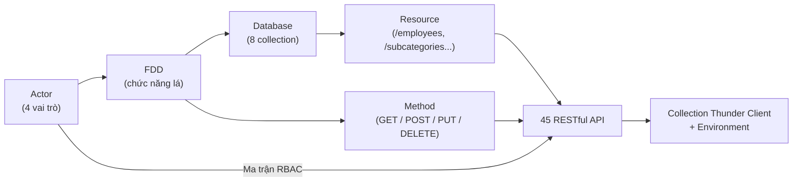
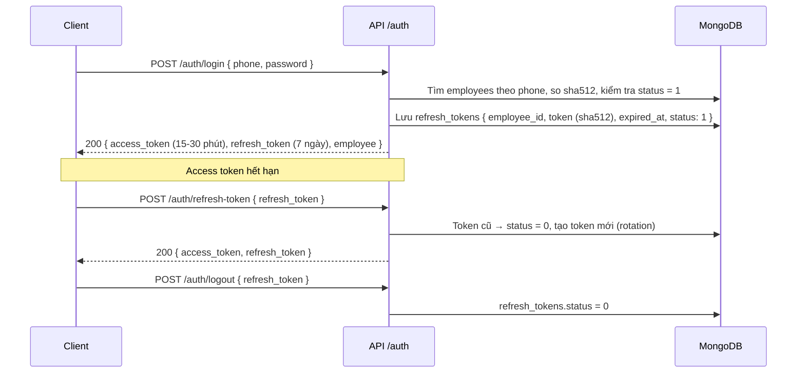
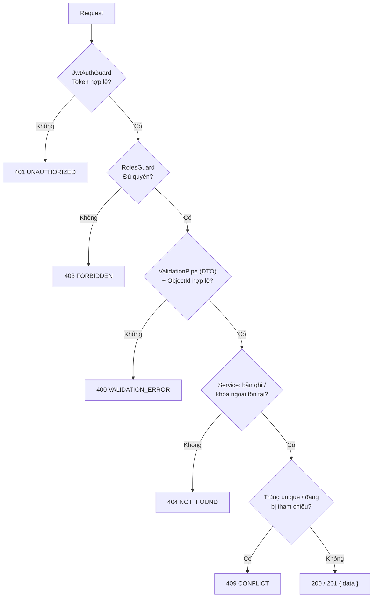

# TỔNG HỢP TƯ DUY: THIẾT KẾ RESTFUL API (MODULE 01 & MODULE 02)

> **Phạm vi tài liệu:** Phương pháp chuyển từ Sơ đồ phân rã chức năng (FDD) và thiết kế Database sang **45 RESTful API** (13 API Module 01 và 32 API Module 02), kèm bộ collection Thunder Client / Postman để nộp bài.
> **Tài liệu đối chiếu:** `md/LessonTwo/bài_tập_api.txt` (đề bài), `md/LessonTwo/api-module-01.md`, `md/LessonTwo/api-module-02.md`, `drawio/LessonTwo/api/*.json`, `.agents/rules/routing.md`, `.agents/rules/api_communication.md`.

---

## 1. Nguyên tắc cốt lõi: API là "cửa ra vào" của Database

Cũng như Database, API không được đặt tên theo cảm tính. API được **dịch trực tiếp từ FDD (chức năng) và Database (dữ liệu)** theo 4 bước:

1. **Mỗi collection là một resource:** tên endpoint là **danh từ số nhiều, trùng tên collection** (`/employees`, `/warehouses`, `/subcategories`). Trong URL không có động từ.
2. **Mỗi chức năng lá trên FDD ứng với 1 method HTTP:** Tạo → `POST`, Xem → `GET`, Sửa → `PUT`, Xóa → `DELETE`. Hành động không phải CRUD (khóa, gán quyền, gán kho) được làm thành **sub-resource**: `PUT /:id/status`, `PUT /:id/role`, `PUT /:id/warehouses`.
3. **Mỗi field trong body là một field trong DB:** body và response dùng đúng tên `snake_case` của collection (`role_id`, `warehouse_ids`, `category_id`). Không đặt tên khác đi.
4. **Mỗi API phải có 3 lớp kiểm soát:** quyền (Actor nào được gọi), validate (dữ liệu vào có đúng không) và ràng buộc nghiệp vụ (trùng, đang được tham chiếu, đang bị khóa...).



---

## 2. Quy ước RESTful chung của dự án

| Quy ước | Áp dụng | Lý do |
|---|---|---|
| Prefix | `{{base_url}}` = `http://localhost:8060/api/v1` | Có version, sau này nâng cấp lên `v2` không làm hỏng client cũ |
| Tên resource | Danh từ số nhiều, `kebab-case`, không có động từ | Đúng chuẩn REST (`routing.md`) |
| Cập nhật | **Luôn dùng `PUT`, không dùng `PATCH`** | Nginx, WAF, Cloudflare và một số client cũ hay chặn hoặc lỗi với `PATCH`. Backend dùng DTO `PartialType` nên vẫn cập nhật từng phần được |
| Body / response | `snake_case`, trùng tên field trong DB | Không phải map tên qua lại, dễ đối chiếu với `Database.drawio` |
| Query params | `camelCase` (`roleId`, `categoryId`, `parentId`, `fromDate`) | Đây là tham số điều khiển API (lọc, phân trang), không phải field DB, theo mẫu `routing.md` mục 5 |
| Xác thực | Header `Authorization: Bearer {{access_token}}` | JWT, trừ API đánh dấu Public |
| HTTP status | Đặt ở header, **không có `statusCode` trong body** | Không lặp thông tin, không có chuyện "200 OK nhưng body báo lỗi" |

**Response chuẩn:**

````carousel
```json
// Thành công (200 / 201)
{ "data": { "_id": "6720f1a2b3c4d5e6f7a8b701", "name": "Kho Hà Nội" } }
```
<!-- slide -->
```json
// Danh sách có phân trang
{
  "data": {
    "items": [],
    "pagination": { "page": 1, "limit": 20, "total": 100, "totalPages": 5 }
  }
}
```
<!-- slide -->
```json
// Thất bại (4xx / 5xx)
{
  "error": {
    "code": "VALIDATION_ERROR",
    "message": "Dữ liệu không hợp lệ",
    "details": [{ "field": "phone", "message": "Số điện thoại đã tồn tại" }]
  }
}
```
````

**Bảng mã lỗi dùng chung:**

| HTTP | `code` | Khi nào |
|---|---|---|
| 400 | `VALIDATION_ERROR` | Body / query sai định dạng, `id` không phải ObjectId |
| 401 | `UNAUTHORIZED` | Thiếu token, token sai / hết hạn, sai phone / mật khẩu |
| 403 | `FORBIDDEN` | Không đủ quyền, tài khoản bị khóa, Staff truy cập kho không được gán |
| 404 | `NOT_FOUND` | Không tìm thấy bản ghi hoặc bản ghi được tham chiếu |
| 409 | `CONFLICT` | Trùng `ID` / `phone` / `sku`, hoặc xóa bản ghi đang được dùng |
| 429 | `TOO_MANY_REQUESTS` | Đăng nhập quá 5 lần / 60 giây |

---

## 3. Bản đồ 45 API theo Resource

### 3.1. Module 01: Người dùng & Phân quyền (13 API)

| Resource | Collection DB | Endpoint | Chức năng FDD |
|---|---|---|---|
| `/auth` | `employees`, `refresh_tokens` | `POST /login`, `POST /refresh-token`, `POST /logout` | 1.1 Xác thực & phiên làm việc |
| `/employees` | `employees` | `GET`, `GET /:id`, `POST`, `PUT /:id`, `PUT /:id/status` | 1.2 Quản lý tài khoản |
| `/roles` | `roles` | `GET`, `GET /:id`, `PUT /:id` | 1.3.1 Quản lý vai trò |
| `/employees/:id/role` | `employees.role_id` | `PUT` | 1.3.2 Gán vai trò |
| `/employees/:id/warehouses` | `employees.warehouse_ids` | `PUT` | 1.4 Gán kho phụ trách |

### 3.2. Module 02: Quản lý Danh mục (32 API)

Mỗi resource có cùng **khung 6–7 API** để dễ nhớ và dễ code:

| Khung chuẩn | `/warehouses` | `/customers` | `/categories` | `/units` | `/subcategories` |
|---|:---:|:---:|:---:|:---:|:---:|
| `GET /` (danh sách + lọc + phân trang) | ✓ | ✓ (`type`) | ✓ (`parentId`) | ✓ | ✓ (`categoryId`, `unitId`) |
| `GET /:id` | ✓ | ✓ | ✓ | ✓ | ✓ |
| `POST /` | ✓ | ✓ | ✓ | ✓ | ✓ |
| `PUT /:id` | ✓ | ✓ | ✓ | ✓ | ✓ |
| `PUT /:id/status` | ✓ | ✓ | ✓ | ✓ | ✓ |
| `DELETE /:id` (chặn 409) | ✓ | ✓ | ✓ | ✓ | ✓ |
| API đặc thù | — | — | `GET /tree` | — | `GET /lookup?code=` |
| **Tổng** | 6 | 6 | 7 | 6 | 7 |

> [!IMPORTANT]
> `/categories/tree` và `/subcategories/lookup` **phải khai báo trước `/:id`** trong NestJS Controller. Nếu không, chữ `tree` / `lookup` sẽ bị hiểu nhầm là `id` và trả 400 (sai định dạng ObjectId).

---

## 4. Các quyết định thiết kế quan trọng (và lý do)

### 4.1. Xác thực: `phone` + `sha512` + cặp Access / Refresh Token



- **Lưu refresh token trong DB:** để **thu hồi được**. Khi Admin khóa nhân viên, toàn bộ refresh token của người đó bị chuyển về `status = 0`, nên người đó bị đẩy ra ngay khi access token hết hạn.
- **Rotation:** mỗi lần refresh sẽ hủy token cũ. Nếu token bị lộ thì chỉ dùng được một lần.

### 4.2. Tách `PUT /:id` (sửa thông tin) và `PUT /:id/status` (khóa / mở)
- Khóa tài khoản kéo theo **hiệu ứng phụ** (thu hồi token, chặn Admin tự khóa mình), khác hẳn việc sửa tên hay số điện thoại.
- Tách riêng giúp **phân quyền chi tiết** và giúp giao diện có nút khóa riêng.
- Tương tự, `role_id` và `warehouse_ids` có API riêng (`/role`, `/warehouses`), **không cho sửa qua `PUT /employees/:id`**.

### 4.3. Xóa: chỉ xóa cứng khi "chưa ai dùng", ngược lại trả 409
Theo quy ước 3.3 của leader, bản ghi được **khóa bằng `status = 0`** chứ không xóa. `DELETE` chỉ dành cho bản ghi tạo nhầm, chưa được bảng nào tham chiếu:

| API | Bị chặn (409) khi còn tham chiếu từ |
|---|---|
| `DELETE /warehouses/:id` | `employees.warehouse_ids`, `import_form.warehouse_id` |
| `DELETE /customers/:id` | `import_form.customer_id`, `payment_form.customer_id`, `debts.customer_id` |
| `DELETE /categories/:id` | `categories.parent_id` (còn danh mục con), `subcategories.category_id` |
| `DELETE /units/:id` | `subcategories.unit_id` |
| `DELETE /subcategories/:id` | `import_form.product[]` / `service[]`.`subcategory_id`, `products.subcategory_id` |

- Nhân viên (`employees`) và vai trò (`roles`) **không có API xóa**. Nhân viên chỉ khóa, còn 4 vai trò được seed sẵn.

### 4.4. `/subcategories` chứ không phải `/products` (và tư duy `sku` vs `products.ID` của Leader)
- Theo Buổi học số 2, `subcategories` là **bảng sản phẩm chung** (mẫu mặt hàng có `sku` `default: null`, `price`, `warranty`), còn `products` là **sản phẩm cuối + mã QR** (`ID`: lấy mã NCC hoặc tự sinh theo `timestamp` `Date.now` khi nhập kho).
- Bảng `subcategories` **không lưu trường `barcode` tĩnh** vì tại Laptop24h, mỗi chiếc linh kiện nhập vào đều có mã định danh QR/barcode cá thể nằm ở `products.ID`.
- Nếu đặt endpoint là `/products` thì sẽ trùng tên với collection `products` của module Nhập kho và vi phạm quy tắc "tên endpoint trùng tên collection".

### 4.5. `/customers` gộp khách hàng, nhà cung cấp và khách thợ
- Dùng chung một resource, phân biệt bằng `type` (`1` khách hàng, `2` nhà cung cấp, `3` khách thợ). Lọc bằng `GET /customers?type=2`.
- **Không cho đổi `type` sau khi tạo**: nhà cung cấp đã gắn vào phiếu nhập (`import_form.customer_id`) mà đổi thành khách hàng thì sổ công nợ sẽ sai.

### 4.6. `GET /subcategories/lookup?code=` tách khỏi `GET /subcategories?keyword=`

| | `?keyword=` | `/lookup?code=` |
|---|---|---|
| Kiểu tìm | Gần đúng, cả có dấu và không dấu (`unsign_search`) | **Chính xác** theo `sku` (hoặc ánh xạ từ mã quét `products.ID` khi đã có module nhập kho) |
| Kết quả | Danh sách có phân trang | **1 bản ghi** hoặc 404 |
| Người dùng | Người gõ tìm trên giao diện | **Máy quét mã** của Warehouse Staff |

### 4.7. `unsign_search` lưu cả có dấu và không dấu (do server tự sinh)
- Client **không gửi** `unsign_search`. Service tự sinh mỗi lần `POST` / `PUT` bằng cách ghép cả nội dung **có dấu** và **không dấu** (chữ thường) của các trường tìm kiếm (`name`, `ID`, `phone`, `sku` tùy bảng).
- Do đặc thù tiếng Việt: lưu cả có dấu và không dấu giúp khi người dùng gõ `keyword=nguyễn` thì khớp đúng chữ có dấu *"Nguyễn"*, còn khi gõ `keyword=nguyen` vẫn tìm được *"Nguyễn Văn A"*.

### 4.8. Danh sách bắt buộc có lọc, ngày và phân trang
Theo `ui_and_ux.md`, mọi API danh sách đều có `page`, `limit`, `keyword`, `status`, `fromDate`, `toDate` (lọc theo `createdAt`), cộng thêm bộ lọc riêng (`type`, `parentId`, `categoryId`, `roleId`, `warehouseId`...). Riêng `/roles` có đúng 4 bản ghi nên không phân trang.

### 4.9. Phạm vi kho của Warehouse Staff (FDD 1.4.3)
- Staff chỉ thấy kho có trong `warehouse_ids` của mình: `GET /warehouses` tự lọc, còn `GET /warehouses/:id` với kho khác trả **403**.
- Quy tắc này sẽ được áp dụng tiếp cho mọi API phiếu nhập / xuất ở các module sau.

---

## 5. Thứ tự xử lý bên trong một request (NestJS)

Thứ tự kiểm tra quyết định **mã lỗi nào được trả về trước**:



- **Controller** chỉ nhận request, gọi DTO và Service. **Service** chứa toàn bộ logic: kiểm tra tồn tại, kiểm tra trùng, sinh `unsign_search`, hash `sha512` (`nestjs.md`).
- Field nhập HTML được sanitize **lúc ghi**. Field text thường (tên, sđt) không được chứa thẻ HTML (`security.md`).

---

## 6. Bộ collection Thunder Client / Postman

| File | Nội dung |
|---|---|
| `drawio/LessonTwo/api/warehouse-api-module-01.postman_collection.json` | 13 request, chia folder theo FDD 1.1 → 1.4 |
| `drawio/LessonTwo/api/warehouse-api-module-02.postman_collection.json` | 33 request (`POST /customers` có 2 mẫu: khách hàng và nhà cung cấp), chia folder theo FDD 2.1 → 2.7 |
| `drawio/LessonTwo/api/warehouse-api.postman_environment.json` | 11 biến: `base_url`, `access_token`, `refresh_token`, `employee_id`, `role_id`, `warehouse_id`, `customer_id`, `parent_category_id`, `category_id`, `unit_id`, `subcategory_id` |

**Cách tổ chức mỗi request:**
- **Tên request** của chức năng lá được đánh số theo FDD (`1.2.1 Tạo tài khoản nhân viên`, `2.7.3 Tra cứu theo mã SKU / mã quét`) để người chấm đối chiếu ngay với sơ đồ. API hỗ trợ (danh sách, chi tiết) không có số.
- **Description** ghi đủ 3 ý: **Quyền**, **Xử lý / ràng buộc**, **Response 2xx và danh sách lỗi**.
- **Không hardcode** token hay id. Mọi giá trị động dùng biến `{{...}}` từ Environment.

**Thứ tự test gợi ý:** `POST /auth/login` → copy `access_token` vào Environment → tạo `units`, `categories` (cha rồi con) → tạo `subcategories` → tạo `warehouses`, `customers` → gán kho cho nhân viên → thử các ca lỗi (trùng `sku` trả 409, xóa danh mục còn sản phẩm trả 409, token Staff gọi API của Admin trả 403).

---

## 7. Checklist tự rà soát trước khi nộp

| # | Kiểm tra | Trạng thái |
|---|---|:---:|
| 1 | Endpoint trong md khớp 100% với collection (Module 01: 13/13, Module 02: 32/32) | ✅ |
| 2 | Không có `PATCH`, không có động từ trong URL | ✅ |
| 3 | Field trong body đều có trong DB (`snake_case`) | ✅ |
| 4 | Query key hợp lệ, URL `raw` khớp mảng `query` | ✅ |
| 5 | Mọi biến `{{...}}` đều có trong Environment | ✅ |
| 6 | Response đúng format `{ data }` / `{ error }`, không có `statusCode` trong body | ✅ |
| 7 | Mọi `DELETE` đều có điều kiện 409 ghi rõ tên bảng / trường tham chiếu | ✅ |
| 8 | Route đặc thù (`/tree`, `/lookup`) được ghi chú khai báo trước `/:id` | ✅ |

---

## 8. Bộ câu hỏi phản biện API thường gặp & Cách trả lời mẫu

### Câu 1: Tại sao dùng `PUT` cho cập nhật một phần mà không dùng `PATCH`?
> Đây là quy ước hạ tầng của dự án: một số reverse proxy, WAF và HTTP client cũ xử lý `PATCH` không ổn định. Phía backend, DTO cập nhật kế thừa `PartialType(CreateDto)` nên `PUT` vẫn nhận được body chỉ có một vài trường, gửi trường nào cập nhật trường đó.

### Câu 2: Khóa tài khoản sao không dùng luôn `PUT /employees/:id` với `{ "status": 0 }`?
> Vì khóa tài khoản có hiệu ứng phụ: thu hồi toàn bộ refresh token, và cấm Admin tự khóa chính mình. Tách thành `PUT /:id/status` giúp logic rõ ràng, dễ phân quyền và dễ ghi log riêng. Theo cùng lý do, `role_id` và `warehouse_ids` cũng có API riêng.

### Câu 3: Tại sao `DELETE` trả 409 mà không tự động xóa mềm?
> Nếu tự xóa mềm thì người dùng tưởng đã xóa, nhưng dữ liệu vẫn nằm trên phiếu nhập và sổ công nợ. Trả 409 kèm thông báo là để nói rõ "bản ghi đang được dùng, hãy khóa bằng `status = 0`". Như vậy hành vi minh bạch, đúng quy ước 3.3 của leader và không phá vỡ toàn vẹn chứng từ.

### Câu 4: Body dùng `snake_case`, sao query lại dùng `camelCase` (`categoryId`)?
> Body là dữ liệu ghi vào DB nên dùng đúng tên field DB (`category_id`). Query là tham số điều khiển API (lọc, phân trang, sắp xếp) và theo chuẩn mẫu trong `routing.md` (`?categoryId=...&fromDate=...`), giống `page`, `limit`, `sortBy`. Hai lớp này có vai trò khác nhau nên quy ước đặt tên khác nhau.

### Câu 5: Sao không có API `/products` ở Module 02 dù đề bài ghi "CRUD sản phẩm"?
> Trong hệ thống Laptop24h, "sản phẩm" mà người dùng CRUD là bảng `subcategories` (mẫu mặt hàng có `sku` `default: null`, `price`, `warranty`). Collection `products` là từng chiếc hàng thực tế kèm mã QR (`ID`), chỉ được sinh tự động khi nhập kho, nên không có API tạo thủ công. Endpoint trùng tên collection nên phải là `/subcategories`.

### Câu 6: Access token đã có hạn 15–30 phút, sao còn cần lưu refresh token vào DB?
> JWT không thể thu hồi trước hạn. Refresh token lưu trong DB thì thu hồi được: khi đăng xuất hoặc khi Admin khóa tài khoản, token chuyển về `status = 0` và không cấp được access token mới. Token được lưu dạng hash `sha512` nên lộ DB cũng không dùng được token.

### Câu 7: Warehouse Staff gọi `GET /warehouses/:id` của kho không được gán thì trả 403 hay 404?
> Trả **403**: Staff đã đăng nhập hợp lệ, kho có tồn tại, nhưng không thuộc phạm vi `warehouse_ids`, tức là thiếu quyền. 404 chỉ dùng khi bản ghi thật sự không tồn tại.
