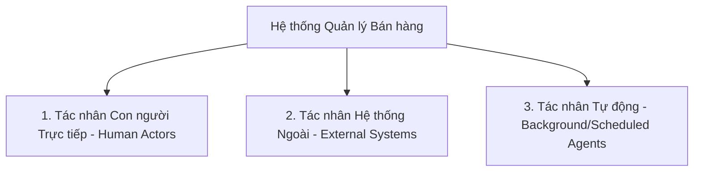
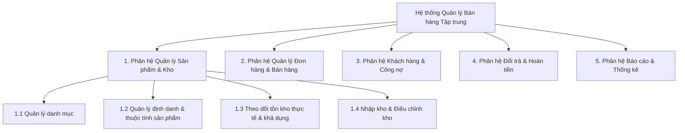

# CẨM NANG TƯ DUY HỆ THỐNG: PHÂN TÍCH TÁC NHÂN & PHÂN RÃ CHỨC NĂNG (BÀI TẬP 1)

> **Mục tiêu tài liệu:** Cung cấp khung lý thuyết, phương pháp luận và bộ công cụ tư duy giúp bạn tự phân tích bài toán, xác định chính xác các tác nhân và tự tay xây dựng sơ đồ phân rã chức năng hoàn chỉnh cho một hệ thống quản lý bán hàng tập trung.

---

## PHẦN 1: BẢN CHẤT CỦA GIAI ĐOẠN PHÂN TÍCH NGHIỆP VỤ

### 1. Chuyển dịch tư duy: Từ "Lập trình viên" sang "Kiến trúc sư giải pháp"
* **Lập trình viên (Coder)** thường nghĩ ngay đến: *Bảng này có những cột nào? Viết API nào? Dùng thư viện gì?*
* **Chuyên viên phân tích / Kiến trúc sư (BA / System Architect)** tiếp cận từ góc nhìn:
  1. **Nỗi đau (Pain points):** Khách hàng/Doanh nghiệp đang gặp bế tắc gì trong vận hành thực tế?
  2. **Giá trị (Business Value):** Hệ thống mới mang lại lợi ích gì (tiết kiệm thời gian, chống thất thoát, tăng doanh thu)?
  3. **Ranh giới (System Boundary):** Hệ thống này làm gì và **không** làm gì?
  4. **Luồng dữ liệu và trách nhiệm:** Ai đưa thông tin vào? Ai xử lý? Ai thụ hưởng kết quả?

### 2. Mô hình phân tích "Problem $\rightarrow$ Goal $\rightarrow$ Feature"
Mọi chức năng trong phần mềm không tự nhiên sinh ra, chúng luôn là lời giải cho một bài toán nghiệp vụ:
* **Vấn đề (Problem):** "Nhiều nhân viên cùng bán dẫn đến vượt tồn kho."
* **Mục tiêu nghiệp vụ (Business Goal):** "Kiểm soát tồn kho theo thời gian thực và ngăn chặn hoàn toàn việc bán quá số lượng có sẵn."
* **Giải pháp hệ thống (System Feature):** "Cơ chế giữ hàng tạm thời (Stock Reservation / Lock) khi tạo đơn hàng nháp."

---

## PHẦN 2: PHƯƠNG PHÁP LUẬN XÁC ĐỊNH TÁC NHÂN (ACTORS)

### 1. Tác nhân (Actor) là gì?
Tác nhân là **bất kỳ thực thể nào nằm ngoài hệ thống** có tương tác trực tiếp hoặc trao đổi thông tin với hệ thống.
* Tác nhân không phải là một con người cụ thể (ví dụ: "Anh Nam", "Chị Lan"), mà là **vai trò (Role)** của họ đối với hệ thống.
* Một người có thể đóng nhiều vai trò, và một vai trò có thể do nhiều người đảm nhiệm.

### 2. Phân loại tác nhân
Để không bỏ sót, hãy chia tác nhân thành 3 nhóm chính:

1. **Tác nhân con người trực tiếp (Primary & Secondary Actors):**
   * Người trực tiếp sử dụng giao diện hệ thống để nhập liệu hoặc tra cứu (ví dụ: Nhân viên bán hàng, Thủ kho, Kế toán, Quản lý).
   * Khách hàng (nếu hệ thống có cổng tự phục vụ như Website mua hàng, App khách hàng).
2. **Tác nhân hệ thống ngoài (External Systems / Services):**
   * Các hệ thống phần mềm bên thứ 3 tương tác qua API hoặc Webhook.
   * *Ví dụ trong bán lẻ:* Cổng thanh toán (VNPAY, MoMo), Đơn vị vận chuyển (GHN, Viettel Post), Nền tảng sàn TMĐT (Shopee, Lazada, TikTok Shop).
3. **Tác nhân tiến trình nền (Time / Automated Process - nếu có):**
   * Bộ lập lịch (Cron job / System Scheduler) tự động kích hoạt các luồng nghiệp vụ theo thời gian (ví dụ: quét đơn hàng quá hạn thanh toán để nhả tồn kho giữ chỗ, gửi báo cáo tổng kết cuối ngày).

### 3. Bộ câu hỏi "truy vết" Tác nhân từ đề bài
Khi đọc đề bài hoặc tài liệu mô tả doanh nghiệp, hãy tự đặt 5 câu hỏi sau:
1. **Ai là người chịu trách nhiệm nhập dữ liệu vào?** (Ai tạo sản phẩm? Ai nhập đơn hàng? Ai xác nhận nhập hàng?)
2. **Ai là người xử lý các bước tiếp theo trong quy trình?** (Ai duyệt đơn? Ai đóng gói, xuất kho? Ai nhận tiền?)
3. **Ai là người xem và sử dụng các báo cáo?** (Ai cần theo dõi doanh thu? Ai kiểm soát công nợ? Ai ra quyết định nhập hàng?)
4. **Hệ thống có nhận/gửi dữ liệu tự động với đối tác bên ngoài nào không?** (Giao hàng, ngân hàng, sàn TMĐT?)
5. **Khách hàng tương tác với hệ thống bằng cách nào?** (Trực tiếp tạo tài khoản mua hàng hay gián tiếp qua nhân viên tư vấn?)

### 4. Cảnh báo những sai lầm phổ biến khi xác định Tác nhân
* ❌ **Nhầm lẫn chức danh ngoài đời với vai trò hệ thống:** Ngoài đời có "Trưởng phòng kinh doanh", "Phó phòng kinh doanh", nhưng trong hệ thống có thể họ chỉ chung một vai trò `Quản lý kinh doanh` với cùng quyền hạn xem báo cáo.
* ❌ **Nhầm lẫn Tác nhân với Thực thể dữ liệu (Data Entity):** Ví dụ: coi "Hóa đơn", "Sản phẩm", "Kho hàng" là tác nhân $\rightarrow$ **Sai**. Đây là đối tượng dữ liệu do tác nhân thao tác.
* ❌ **Bỏ sót tác nhân gián tiếp hoặc tác nhân ngoại vi:** Quên mất các hệ thống bên ngoài như Đơn vị vận chuyển hay Cổng thanh toán.

---

## PHẦN 3: PHƯƠNG PHÁP XÂY DỰNG SƠ ĐỒ PHÂN RÃ CHỨC NĂNG (FDD)

### 1. Sơ đồ phân rã chức năng (Functional Decomposition Diagram - FDD) là gì?
FDD là sơ đồ thể hiện cấu trúc phân cấp từ trên xuống (Top-down) của toàn bộ các chức năng trong hệ thống. Phương pháp này áp dụng nguyên lý **"Chia để trị" (Divide and Conquer)**: biến một bài toán lớn phức tạp thành các bài toán con nhỏ hơn và dễ quản lý.

### 2. Các cấp bậc phân rã chuẩn mực
* **Cấp 0 (Root Level):** Toàn bộ hệ thống tổng thể.
* **Cấp 1 (Module / Subsystem Level - Phân hệ chức năng):** Các khối nghiệp vụ lớn, độc lập tương đối về mặt mục tiêu (ví dụ: Bán hàng, Kho vận, Kế toán - Công nợ, Khách hàng, Báo cáo).
* **Cấp 2 (Business Feature Level - Chức năng nghiệp vụ):** Các công việc nghiệp vụ cụ thể thuộc phân hệ (ví dụ: Lập đơn bán hàng, Nhập hàng từ nhà cung cấp, Xử lý yêu cầu đổi trả).
* **Cấp 3 (Detailed Action / Task Level - Tác vụ chi tiết):** Các thao tác thực tế cấu thành chức năng (ví dụ: Tìm kiếm sản phẩm, Giữ chỗ tồn kho, Áp mã giảm giá, In hóa đơn).

### 3. Nguyên tắc vàng khi thiết kế FDD: Quy tắc MECE
**MECE** là viết tắt của *Mutually Exclusive, Collectively Exhaustive* (Không trùng lặp - Không bỏ sót):
* **Không trùng lặp (Mutually Exclusive):** Một chức năng không được nằm ở hai nơi khác nhau gây xung đột trách nhiệm. Ví dụ: Chức năng "Hủy đơn hàng" nên thuộc phân hệ Đơn hàng, không nên để lẫn sang phân hệ Báo cáo hay Phân hệ Khách hàng.
* **Không bỏ sót (Collectively Exhaustive):** Khi gộp tất cả các chức năng con lại, chúng phải bao quát được 100% mục tiêu mà phân hệ đó đặt ra.

### 4. Quy ước đặt tên chức năng
* Tên chức năng **BẮT BUỘC** phải bắt đầu bằng một **ĐỘNG TỪ** đi kèm với một **DANH TỪ** (Verb + Noun).
* *Ví dụ đúng:* "Quản lý tồn kho", "Tiếp nhận đơn hàng", "Tính toán công nợ", "Kiểm tra giới hạn tồn", "Xuất báo cáo doanh thu".
* *Ví dụ sai:* "Kho hàng", "Excel", "Nhân viên", "Website" (Đây là danh từ chỉ thực thể hoặc công cụ, không phải chức năng).

---

## PHẦN 4: KIẾN THỨC NGHIỆP VỤ MIỀN (DOMAIN KNOWLEDGE) CHO BÀI TẬP 1

Để làm bài tập 1 một cách sắc bén, bạn cần nắm rõ 4 khái niệm nghiệp vụ cốt lõi sau:

### 1. Bài toán Tồn kho: On-Hand vs Reserved vs Available
Vấn đề lớn nhất của Công ty ABC là: *"Nhiều nhân viên cùng bán dẫn đến vượt số lượng tồn"*. Trong hệ thống thực tế, không bao giờ dùng một con số tồn kho duy nhất.

$$\text{Tồn khả dụng (Available)} = \text{Tồn vật lý trong kho (On-Hand)} - \text{Tồn đang giữ chỗ (Reserved / Committed)}$$

* **On-Hand (Tồn thực tế):** Số lượng máy móc/linh kiện đang nằm vật lý trên giá kệ của kho.
* **Reserved (Tồn giữ chỗ):** Số lượng hàng đã được khách đặt (trên web, qua điện thoại, hoặc nhân viên đang tạo đơn nháp) nhưng chưa đóng gói xuất kho.
* **Available (Tồn khả dụng):** Số lượng thực sự còn lại có thể bán cho người tiếp theo.
$\rightarrow$ *Chức năng bạn cần nghĩ tới: "Kiểm tra tồn khả dụng tức thời" và "Khóa/Giữ chỗ tồn kho khi tạo đơn".*

### 2. Tiếp nhận đơn hàng đa kênh (Omnichannel Order Ingestion)
Đề bài nêu: *"Đơn hàng được ghi nhận từ cửa hàng (POS), điện thoại (Telesale) và website nhưng chưa tập trung."*
* Luồng nghiệp vụ cần phân rã:
  * Tiếp nhận đơn tự động từ Website.
  * Nhập đơn thủ công từ kênh Điện thoại / Trực tiếp tại quầy.
  * Đồng bộ trạng thái đơn hàng về một danh sách duy nhất.
  * Phân bổ kho xử lý cho đơn hàng.

### 3. Nghiệp vụ Đổi trả & Hoàn tiền (Reverse Logistics)
Đề bài nêu: *"Việc đổi trả hàng, hoàn tiền và điều chỉnh tồn kho chưa có quy trình thống nhất."*
Một quy trình đổi trả chuẩn gồm 3 bài toán chạy song song:
1. **Dòng vật chất (Hàng hóa):** Kiểm tra tình trạng hàng trả lại $\rightarrow$ Nhập lại vào kho (hàng tốt) hoặc chuyển vào kho thanh lý/bảo hành (hàng lỗi).
2. **Dòng tiền tệ (Tài chính):** Hoàn tiền mặt, chuyển khoản hoặc cấn trừ vào công nợ của khách.
3. **Dòng chứng từ:** Lập phiếu yêu cầu đổi trả, phiếu nhập kho hàng trả, phiếu chi hoàn tiền.

### 4. Quản lý Công nợ khách hàng (Accounts Receivable)
Đề bài nêu: *"Khó theo dõi công nợ khách hàng, doanh thu và hiệu quả của từng nhân viên."*
* Bán hàng không phải lúc nào cũng thu tiền ngay 100%. Khách buôn/đối tác thường thanh toán trả chậm hoặc đặt cọc.
* Cần các chức năng: Thiết lập hạn mức nợ, ghi nhận thanh toán từng phần, theo dõi tuổi nợ (quá hạn bao nhiêu ngày), đối soát công nợ định kỳ.

---

## PHẦN 5: BỘ CHECKLIST HƯỚNG DẪN TỰ THỰC HIỆN BÀI TẬP 1

Dưới đây là các bước bạn hãy tự mình thực hành từng bước trên giấy hoặc file nháp:

### Bước 1: Liệt kê danh sách Tác nhân (Actors)
* [ ] Đọc lại bối cảnh Công ty ABC và gạch chân các đối tượng con người xuất hiện (Ai bán? Ai kiểm kho? Ai quản lý? Ai mua?).
* [ ] Kiểm tra xem ngoài con người, có hệ thống bên ngoài nào cần kết nối không (Kênh bán website? Đơn vị giao vận?).
* [ ] Gom nhóm các chức danh thành **vai trò hệ thống chuẩn hóa** (Ví dụ: Nhân viên bán hàng, Nhân viên kho, Nhân viên kế toán/thu ngân, Quản trị viên/Quản lý).
* [ ] Mô tả ngắn gọn trách nhiệm chính của từng tác nhân trong hệ thống (1-2 câu).

### Bước 2: Thiết kế Sơ đồ phân rã chức năng (FDD)
* [ ] **Xác định các Nhóm chức năng cấp 1:** Dựa vào 6 mục tiêu của đề bài, bạn dự định chia hệ thống thành mấy phân hệ lớn? (Gợi ý: thường từ 4 đến 6 phân hệ lớn).
* [ ] **Bổ sung các Chức năng cấp 2:** Với mỗi phân hệ, liệt kê các việc cần làm.
  * *Ví dụ với phân hệ Tồn kho:* Cần những chức năng gì để nhân viên biết số lượng tồn? Cần chức năng gì khi hàng về kho? Cần chức năng gì khi kiểm kê thấy sai lệch?
  * *Ví dụ với phân hệ Bán hàng:* Khi khách đặt hàng thì quy trình từ tạo đơn, giữ hàng, thanh toán đến giao hàng gồm những chức năng nào?
* [ ] **Rà soát quy tắc MECE:**
  * Có chức năng nào bị trùng lặp giữa 2 phân hệ không?
  * Đã giải quyết được hết 6 vấn đề tồn đọng của công ty ABC chưa?
* [ ] **Kiểm tra cú pháp:** Toàn bộ các ô chức năng đã dùng cấu trúc `Động từ + Danh từ` chưa?

---

## BƯỚC TIẾP THEO DÀNH CHO BẠN
Hãy lấy giấy bút hoặc mở một file nháp, áp dụng các nguyên tắc trên để:
1. Viết ra danh sách các tác nhân mà bạn phân tích được.
2. Vẽ hoặc phác thảo danh sách cây phân rã chức năng từ Cấp 1 đến Cấp 2 (và Cấp 3 nếu có).

Khi bạn hoàn thành bản nháp hoặc có bất kỳ câu hỏi nào cần trao đổi sâu hơn về mặt tư duy, hãy gửi nội dung của bạn lên đây. Chúng ta sẽ cùng nhau phản biện (review), mổ xẻ các góc khuất nghiệp vụ và tinh chỉnh lại cho hoàn thiện nhất!
